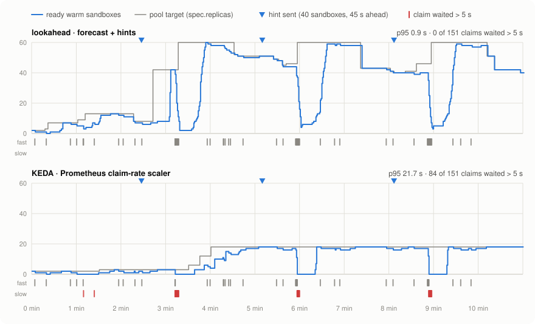
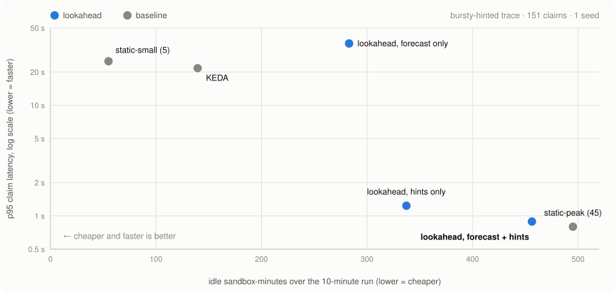
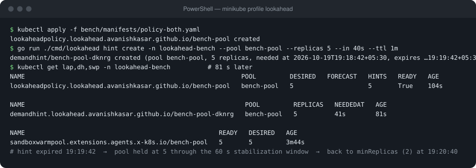

# lookahead

**Warm sandboxes before the burst, not after it.**

[](go.mod)
[](LICENSE)
[](https://github.com/kubernetes-sigs/agent-sandbox)


lookahead is a Kubernetes controller that sizes
[agent-sandbox](https://github.com/kubernetes-sigs/agent-sandbox) `SandboxWarmPool`s **ahead** of
demand. It combines a short-horizon forecast of claim arrivals with **demand hints**: agents and
orchestrators announce *"I will need N sandboxes from pool P in T seconds"*, and the pool is warm
when they arrive.

<picture>
  <source media="(prefers-color-scheme: dark)" srcset="docs/img/timeline-dark.svg">
  
</picture>

<sub>Measured on minikube with the bench harness: the same trace replayed against lookahead (forecast + hints) and against KEDA's Prometheus scaler.
Each ▼ is a hint sent 45 s before a burst of 40 claims. The ticks under each panel are claims; red ones waited more than 5 s.</sub>

## Why

Agent workloads come in bursts: an RL step, a batch of evals, a fan-out of tool calls. A sandbox
can take tens of seconds to become Ready, so a warm pool has to be big *before* the burst lands.
The options people use today both miss:

- **Static pools** are either too small (claims fall through to cold starts) or sized for peak
  (you pay for idle sandboxes all day).
- **Reactive autoscalers** (HPA, KEDA) scale on the claim rate they have *already seen*. By the time
  the rate rises, the burst is here, and the new sandboxes are still starting.

The orchestrator usually knows the burst is coming. lookahead lets it say so.

## Use it from Claude Code or Codex

The `lookahead` binary is also a stdio **MCP server**, so any coding agent that speaks MCP can
announce a fan-out before it claims the sandboxes. It then sees what the controller did, in a
brief and a text card:

```powershell
claude mcp add lookahead -- lookahead mcp -n my-namespace                  # Claude Code
# Codex: ~/.codex/config.toml →  [mcp_servers.lookahead]  command = "lookahead"  args = ["mcp", "-n", "my-namespace"]
```

```text
Created demandhint/rl-step-7: +6 sandboxes for bench-pool, needed at 16:30:19, counting until 16:30:49.
lookahead counted it after 300ms: target 2 → 6.

╭─ bench-pool  lookahead-bench  16:30:09
│ ready     █▒▒▒░░░░░░░░░░░░░░░░░░░░░░░░░░░░░░░░  2 ready · 6 target · max 60
│ target    6 = forecast 0 + hints 6 (1 active) · clamp [2, 60]
│ hints     ● rl-step-7            +6    active   needed in 10s · expires in 40s
╰─
```

<picture>
  <source media="(prefers-color-scheme: dark)" srcset="docs/img/dashboard-dark.png">
  
</picture>

Agents without MCP use the same thing through the shell: `lookahead hint create` and
`lookahead status`. You can watch it live with `lookahead watch` in a terminal or
`lookahead dashboard` in the browser. The setup for each agent, a ready-made `AGENTS.md` /
`CLAUDE.md` snippet and a least-privilege Role are in [docs/agents.md](docs/agents.md).

## Results

First run: one seed of the `bursty-hinted` trace, which has 151 claims and three bursts of 40 claims, each
announced 45 s ahead. Sandboxes take about 20 s to become Ready.

<picture>
  <source media="(prefers-color-scheme: dark)" srcset="docs/img/tradeoff-dark.svg">
  
</picture>

| Strategy | p50 | p95 | p99 | Claims waiting > 5 s | Cold starts | Idle sandbox-min |
|---|---:|---:|---:|---:|---:|---:|
| **lookahead: forecast + hints** | **0.43 s** | **0.89 s** | **0.93 s** | **0 %** | **0 %** | 456 |
| lookahead: hints only | 0.50 s | 1.24 s | 11.1 s | 2.0 % | 0 % | 337 |
| lookahead: forecast only | 20.5 s | 36.3 s | 37.9 s | 66.9 % | 37.1 % | 283 |
| KEDA (Prometheus scaler, 2–60) | 18.4 s | 21.7 s | 22.6 s | 55.6 % | 4.0 % | 140 |
| static pool, 5 | 20.5 s | 25.0 s | 26.1 s | 70.2 % | 29.8 % | 55 |
| static pool, 45 (peak) | 0.41 s | 0.80 s | 0.89 s | 0 % | 0 % | 495 |

**What this shows**

- **Hints do the work.** With hints the pool is full when each burst lands. Hints alone get
  p95 down to 1.2 s; adding the forecast cleans up the tail (p99 11.1 s → 0.93 s).
- **It is not free.** lookahead with forecast and hints matches a pool sized for peak on latency and uses 8 % fewer
  idle sandbox-minutes. That is a small saving on this trace. Against KEDA it is 24× faster at p95, and it uses
  3.3× the idle capacity.
- **The forecast alone does not help with bursts.** Holt only reacts to arrivals it has already seen, so on
  this trace it behaves like a slow reactive scaler and then overshoots.
- **Cold-start rate understates waiting.** Under KEDA only 4 % of claims are labelled cold, but
  56 % wait more than 5 s. They bind to warm-pool members that exist but are not Ready yet. That
  is why the table shows both columns.

> [!NOTE]
> This is one seed, one trace and 151 claims on a single-node minikube, so treat the numbers as directional.
> The multi-seed runs, the `steady` and `bursty-unhinted` traces and the HPA baseline are still to do
> (see [Roadmap](#roadmap)). The full method is in [bench/README.md](bench/README.md).

## How it works

```
target = clamp(ceil(E + z·√E) + Σ active hints, minReplicas, maxReplicas)
         E = Holt forecast of claim arrivals over leadTimeSeconds
pool.spec.replicas = max(target over the last scaleDownStabilizationSeconds)
```

Two CRDs in `lookahead.avanishkasar.github.io/v1alpha1`:

- **LookaheadPolicy** (`lap`) targets one pool and owns its `spec.replicas`. If an HPA (or a KEDA
  ScaledObject's HPA) or an older policy targets the same pool, it writes nothing and sets
  `ScaleTargetConflict=True`.
- **DemandHint** (`dh`) counts from `neededAt − leadTime` until `neededAt + ttlSeconds`, then the
  controller deletes it. Agents need only `create` on `demandhints`, never access to the pool.

Arrivals are counted from the `SandboxClaim` informer (`spec.warmPoolRef.name`), so there is no
Prometheus dependency. After a restart, history is rebuilt from the existing claims.

```yaml
apiVersion: lookahead.avanishkasar.github.io/v1alpha1
kind: LookaheadPolicy
metadata:
  name: bench-pool
spec:
  poolRef:
    name: bench-pool
  minReplicas: 2
  maxReplicas: 60
  leadTimeSeconds: 30
  scaleDownStabilizationSeconds: 60
  forecast:
    model: Holt          # or None for hints only
---
# "I will need 20 sandboxes from python-sdk-warmpool." Usually created with `lookahead hint create`.
apiVersion: lookahead.avanishkasar.github.io/v1alpha1
kind: DemandHint
metadata:
  generateName: rl-step-
spec:
  poolRef:
    name: python-sdk-warmpool
  replicas: 20
  ttlSeconds: 120
```

## See it work

A hint for 5 sandboxes, sent 40 s ahead, against a live pool:



The pool reached 5 within 10 s of the hint. It stayed there until the hint expired plus the 60 s
stabilization window, then returned to `minReplicas`.

## Quick start

Needs Go 1.21+ (it downloads the pinned toolchain), minikube, kubectl, helm and PowerShell 7. The bench scripts work on Windows, Linux and macOS.

```powershell
./bench/setup.ps1                  # minikube + agent-sandbox v1.0.7 + lookahead + Prometheus + KEDA
kubectl apply -f bench/manifests/policy-both.yaml
go run ./cmd/lookahead hint create -n lookahead-bench --pool bench-pool --replicas 5 --in 40s --ttl 1m
kubectl get lap,dh,swp -n lookahead-bench
```

To reproduce the results above, run `./bench/run.ps1 -Traces bursty-hinted -Seeds 1 -Duration 10m`
(about 1.5 h). It writes `bench/results/report.md`.

### Development

```powershell
go generate ./...                  # CRDs, RBAC, deepcopy (after changing api/ or RBAC markers)
go test -race ./...
kubectl apply -k config/default    # needs image lookahead-controller:dev (see bench/setup.ps1)
```

## Layout

| Path | |
|---|---|
| `api/v1alpha1` | LookaheadPolicy, DemandHint |
| `internal/forecast` | Holt/EWMA, sizing, scale-down stabilizer (pure functions) |
| `internal/arrivals` | per-pool claim arrival counter |
| `internal/controller` | policy and hint-expiry reconcilers |
| `internal/trace`, `internal/replay` | trace generator, replayer, summary and report |
| `internal/inspect` | live pool snapshots, the brief and the text card |
| `internal/mcpserver`, `internal/dashboard` | MCP server for agents; localhost web dashboard |
| `cmd/lookahead-controller` | controller manager |
| `cmd/lookahead` | CLI: `hint`, `status`, `watch`, `dashboard`, `mcp`, `trace generate`, `replay`, `report` |
| `bench/` | benchmark setup, baselines and runner ([bench/README.md](bench/README.md)) |
| `docs/` | KEP and issue drafts, README figures |

## Roadmap

- [x] LookaheadPolicy and DemandHint controllers, Holt forecast, scale-down stabilization
- [x] Benchmark harness: trace generator, replayer, static, KEDA and HPA baselines
- [x] First run on `bursty-hinted`
- [x] MCP server for Claude Code, Codex and other agents; `status`, `watch` and a web dashboard
- [ ] 3 seeds × 3 traces (`steady`, `bursty-hinted`, `bursty-unhinted`) and the HPA baseline
- [ ] A "claims waiting > 5 s" column in the generated report
- [ ] Upstream proposal to agent-sandbox

## Status

This is an out-of-tree prototype for an upstream proposal. The API group
`lookahead.avanishkasar.github.io/v1alpha1` exists only to collect data, and the upstream API shape
is still open. See [the KEP draft](docs/keps/NNNN-lookahead/README.md) and the
[issue draft](docs/issue-draft.md). Feedback and benchmark results from real agent workloads are
very welcome. Open an issue.

## License

[MIT](LICENSE)
