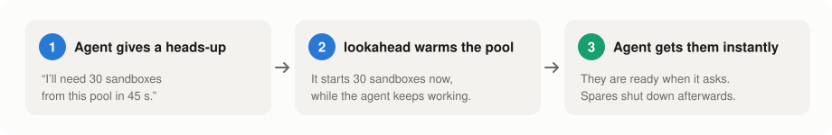
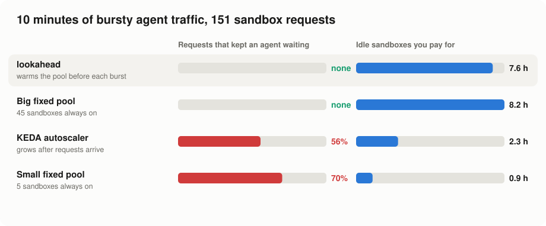

# lookahead

**Your AI agent asks for 30 sandboxes. With lookahead they are already warm.**

[](https://github.com/avanishkasar/lookahead/releases/latest)
[](go.mod)
[](LICENSE)
[](https://github.com/kubernetes-sigs/agent-sandbox)


<picture>
  <source media="(prefers-color-scheme: dark)" srcset="docs/img/race-dark.svg">
  
</picture>

<sub>Real runs on a local Kubernetes cluster. Same task for every run; the agents were not told about lookahead.</sub>

## The problem

Agents use sandboxes in bursts: a batch of evals, an RL step, a fan-out of tool calls. A new
sandbox takes about 20 seconds to start. So when 30 requests land at once, the agent sits and
waits, unless the sandboxes were started *before* it asked.

Keeping a big pool running all the time fixes the wait but costs money all day. Autoscalers only
grow the pool *after* the requests arrive, which is too late.

## The fix: a heads-up

<picture>
  <source media="(prefers-color-scheme: dark)" srcset="docs/img/steps-dark.svg">
  
</picture>

lookahead is a small Kubernetes controller for
[agent-sandbox](https://github.com/kubernetes-sigs/agent-sandbox) warm pools. The agent (or your
orchestrator) sends one line, the pool grows ahead of time, and shrinks again when the burst is over.

## Does it help?

<picture>
  <source media="(prefers-color-scheme: dark)" srcset="docs/img/scoreboard-dark.svg">
  
</picture>

- ✅ **No waiting.** lookahead is as fast as keeping a big pool on all the time.
- ✅ **No guessing the peak.** You don't have to know how big the pool must be; the heads-ups say so.
- ⚠️ **Not free.** Warm sandboxes cost money while they wait. On this test lookahead saved only a
  little over the big pool (7.6 vs 8.2 idle hours), and used more than KEDA, which keeps half the
  requests waiting.
- ⚠️ **Early results.** One test run on one machine. More runs are on the [roadmap](#roadmap).
  Full numbers and method: [bench/README.md](bench/README.md).

## Download

The `lookahead` command line tool is also the **MCP server** for agents. One file, no installer.

| System | Download |
|---|---|
| Windows (x64) | [lookahead-windows-amd64.zip](https://github.com/avanishkasar/lookahead/releases/latest/download/lookahead-windows-amd64.zip) |
| Windows (ARM) | [lookahead-windows-arm64.zip](https://github.com/avanishkasar/lookahead/releases/latest/download/lookahead-windows-arm64.zip) |
| macOS (Apple silicon) | [lookahead-macos-arm64.tar.gz](https://github.com/avanishkasar/lookahead/releases/latest/download/lookahead-macos-arm64.tar.gz) |
| macOS (Intel) | [lookahead-macos-amd64.tar.gz](https://github.com/avanishkasar/lookahead/releases/latest/download/lookahead-macos-amd64.tar.gz) |
| Linux (x64) | [lookahead-linux-amd64.tar.gz](https://github.com/avanishkasar/lookahead/releases/latest/download/lookahead-linux-amd64.tar.gz) |
| Linux (ARM) | [lookahead-linux-arm64.tar.gz](https://github.com/avanishkasar/lookahead/releases/latest/download/lookahead-linux-arm64.tar.gz) |

Unpack it and put `lookahead` (or `lookahead.exe`) somewhere on your `PATH`. With Go installed you
can instead run `go install github.com/avanishkasar/lookahead/cmd/lookahead@latest`.
Checksums are on the [release page](https://github.com/avanishkasar/lookahead/releases/latest).

It talks to your cluster with your normal kubeconfig, like `kubectl`. The cluster needs the
lookahead controller; see [Try it on your machine](#try-it-on-your-machine).

## Connect your agent

**Claude Code**

```powershell
claude mcp add lookahead -- lookahead mcp -n my-namespace
```

**Codex**: add to `~/.codex/config.toml`

```toml
[mcp_servers.lookahead]
command = "lookahead"
args = ["mcp", "-n", "my-namespace"]
```

Then paste the short [`AGENTS.md` / `CLAUDE.md` snippet](docs/agents.md#3-tell-the-agent-when-to-hint)
into your project so the agent knows to give a heads-up before a big batch. Claude Code did it
on its own in our test; Codex needed the snippet.

Any other agent can use the same tool from its shell:

```powershell
lookahead hint create -n my-namespace --pool my-pool --replicas 30 --in 45s
```

## See what it's doing

The agent gets a plain answer back, and you can watch the pool live.

```text
Created demandhint/rl-step-7: +6 sandboxes for bench-pool, needed at 16:30:19.
lookahead counted it after 300ms: target 2 → 6.

╭─ bench-pool  lookahead-bench  16:30:09
│ ready     █▒▒▒░░░░░░░░░░░░░░░░░░░░░░░░░░░░░░░░  2 ready · 6 target · max 60
│ hints     ● rl-step-7            +6    active   needed in 10s · expires in 40s
╰─
```

| Command | Shows |
|---|---|
| `lookahead status` | the card above, once |
| `lookahead watch` | the card, live in your terminal |
| `lookahead dashboard` | a live page on <http://127.0.0.1:8484> |

<picture>
  <source media="(prefers-color-scheme: dark)" srcset="docs/img/dashboard-dark.png">
  
</picture>

How the agent tests were run, with the agents' own sessions: [docs/agent-demo.md](docs/agent-demo.md).
Setup details and permissions: [docs/agents.md](docs/agents.md).

## Try it on your machine

Needs minikube, kubectl, helm, Go and PowerShell 7 (Windows, macOS or Linux).

```powershell
git clone https://github.com/avanishkasar/lookahead; cd lookahead
./bench/setup.ps1                                   # local cluster + agent-sandbox + lookahead
go install ./cmd/lookahead                          # or use the download above
kubectl apply -f bench/manifests/policy-both.yaml   # let lookahead manage the test pool
lookahead hint create -n lookahead-bench --pool bench-pool --replicas 5 --in 40s
lookahead watch -n lookahead-bench                  # watch the pool grow to 5
```


## How it works

Two Kubernetes objects:

- **LookaheadPolicy**: "lookahead manages this pool, between 2 and 60 sandboxes."
- **DemandHint**: the heads-up. "I'll need 20 sandboxes from this pool in 45 seconds, for 2 minutes."

The pool size is *what the recent traffic suggests* **plus** *every active heads-up*. When a
heads-up expires, the pool waits a minute and then shrinks back.

<details>
<summary>The exact rule and YAML</summary>

```
target = clamp(ceil(E + z·√E) + Σ active hints, minReplicas, maxReplicas)
         E = Holt forecast of claim arrivals over leadTimeSeconds
pool.spec.replicas = max(target over the last scaleDownStabilizationSeconds)
```

Both CRDs are in `lookahead.avanishkasar.github.io/v1alpha1`. A policy that finds an HPA, a KEDA
ScaledObject or an older policy on the same pool writes nothing and reports
`ScaleTargetConflict=True`. A hint counts from `neededAt − leadTime` until `neededAt + ttlSeconds`,
then the controller deletes it. Agents need only `create` on `demandhints`. Arrivals are counted
from `SandboxClaim`s directly, so there is no Prometheus dependency.

```yaml
apiVersion: lookahead.avanishkasar.github.io/v1alpha1
kind: LookaheadPolicy
metadata:
  name: bench-pool
spec:
  poolRef:
    name: bench-pool
  minReplicas: 2
  maxReplicas: 60
  leadTimeSeconds: 30
  scaleDownStabilizationSeconds: 60
  forecast:
    model: Holt          # or None for hints only
---
apiVersion: lookahead.avanishkasar.github.io/v1alpha1
kind: DemandHint
metadata:
  generateName: rl-step-
spec:
  poolRef:
    name: python-sdk-warmpool
  replicas: 20
  ttlSeconds: 120
```

</details>

## Development

```powershell
go generate ./...                  # CRDs, RBAC, deepcopy (after changing api/ or RBAC markers)
go test -race ./...
kubectl apply -k config/default    # needs image lookahead-controller:dev (see bench/setup.ps1)
```

<details>
<summary>Repository layout</summary>

| Path | |
|---|---|
| `api/v1alpha1` | LookaheadPolicy, DemandHint |
| `internal/forecast` | Holt/EWMA, sizing, scale-down stabilizer (pure functions) |
| `internal/arrivals` | per-pool claim arrival counter |
| `internal/controller` | policy and hint-expiry reconcilers |
| `internal/trace`, `internal/replay` | trace generator, replayer, summary and report |
| `internal/inspect` | live pool snapshots, the brief and the text card |
| `internal/mcpserver`, `internal/dashboard` | MCP server for agents; localhost web dashboard |
| `cmd/lookahead-controller` | controller manager |
| `cmd/lookahead` | CLI: `hint`, `status`, `watch`, `dashboard`, `mcp`, `trace generate`, `replay`, `report` |
| `bench/` | benchmark setup, baselines, runner and agent demo ([bench/README.md](bench/README.md)) |
| `docs/` | agent guides, KEP and issue drafts, README figures |

</details>

## Roadmap

- [x] LookaheadPolicy and DemandHint controllers, forecast, gentle scale-down
- [x] Benchmark against fixed pools and KEDA
- [x] MCP server for Claude Code, Codex and other agents; `status`, `watch` and a web dashboard
- [x] Tested with real Claude Code and Codex sessions
- [ ] More test runs and traffic shapes, plus the HPA baseline
- [ ] Stop counting a heads-up twice once its requests arrive (the pool briefly overshoots today)
- [ ] Upstream proposal to agent-sandbox

## Status

An out-of-tree prototype for an upstream proposal. The API group
`lookahead.avanishkasar.github.io/v1alpha1` exists only to collect data. See
[the KEP draft](docs/keps/NNNN-lookahead/README.md) and the [issue draft](docs/issue-draft.md).
Feedback and results from real agent workloads are very welcome. Open an issue.

## License

[MIT](LICENSE)
