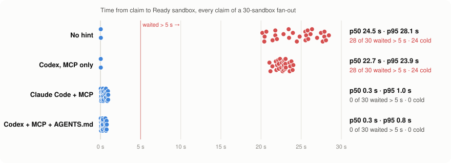
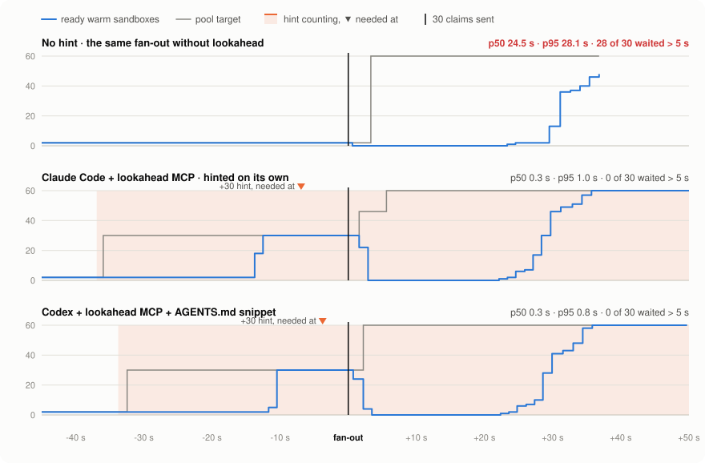
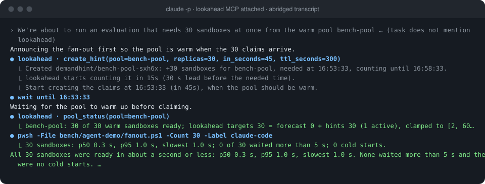
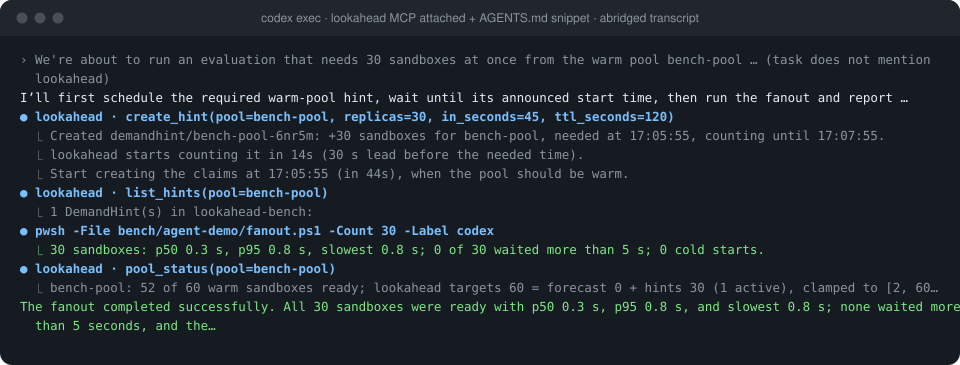

# Agent demo: Claude Code and Codex with lookahead

Can a coding agent use lookahead without being told to, and does it help? To find out, real
headless Claude Code and Codex sessions were given the same plain task: *"We're about to run an
evaluation that needs 30 sandboxes at once from the warm pool bench-pool … Run it with
`fanout.ps1 -Count 30`, then tell me how long the sandboxes took to become ready."* The task
does not mention lookahead or hints.

Both agents had the lookahead MCP server attached. The baseline is the same fan-out with no
hint, which is what an agent does without lookahead.

## Result

<picture>
  <source media="(prefers-color-scheme: dark)" srcset="img/agents-latency-dark.svg">
  
</picture>

| Run | Hinted? | p50 | p95 | Waited > 5 s | Cold starts |
|---|---|---:|---:|---:|---:|
| No hint (run 1) | no | 24.1 s | 28.0 s | 28 of 30 | 28 |
| No hint (run 2) | no | 24.5 s | 28.1 s | 28 of 30 | 24 |
| **Claude Code + MCP** | **on its own, via MCP** | **0.34 s** | **0.96 s** | **0 of 30** | **0** |
| Codex + MCP | no; ran the script directly | 22.7 s | 23.9 s | 28 of 30 | 24 |
| Codex + MCP + first snippet | yes, via the shell, but claimed at once | 22.6 s | 25.8 s | 28 of 30 | 24 |
| **Codex + MCP + `AGENTS.md` snippet** | **yes, via MCP, and waited** | **0.28 s** | **0.76 s** | **0 of 30** | **0** |

**Hinted the right way, a 30-sandbox fan-out goes from about 24 s at p50 to under half a
second, with no claim waiting.** It costs about 5 extra idle sandbox-minutes per fan-out:
30 sandboxes sit warm for the ~40 s between the hint and the claims. In the 45 s before the
fan-out, idle sandbox-minutes were 6.1 (Claude Code) and 5.5 (Codex) against 1.2 without a hint.

## What happened in each session

<picture>
  <source media="(prefers-color-scheme: dark)" srcset="img/agents-timeline-dark.svg">
  
</picture>

**Claude Code** read the script, saw it sends no hint, and wrote *"Announcing the fan-out first
so the pool is warm when the 30 claims arrive."* It called `create_hint`, waited until the
needed time, checked `pool_status` (30 of 30 ready), then ran the fan-out. The task said nothing
about lookahead. What it had was the MCP server's connect-time instructions ("before you create
many SandboxClaims … call create_hint") and the script's header, which notes that it sends no
DemandHint.



**Codex** (CLI 0.163) lists and calls the lookahead tools when asked, but with the MCP server
alone it went straight to the script. With the [`AGENTS.md` snippet](agents.md#3-tell-the-agent-when-to-hint)
it hinted. The first version of the snippet did not say to wait, so Codex claimed at once,
while the pool was still warming, and gained nothing. The `hint create` CLI output and the
snippet now both say *"Start creating the claims at …"*. With that, Codex used the MCP tool,
waited, and every claim was served from the warm pool.



## What this shows, and what it does not

- **The integration works in both agents.** Claude Code acts on MCP server instructions alone.
  Codex needs a line in `AGENTS.md`, which is the documented setup anyway.
- **Hints have to arrive early.** A hint sent just before the claims does nothing: sandboxes
  take about 20 s to become Ready. Tool output now says when to start claiming.
- **The pool overshoots after the burst.** In every run, including the baseline, the target
  goes to `maxReplicas` (60) right after the fan-out. The forecast sees 30 arrivals in one
  bucket and extrapolates, and in the hinted runs the hint still counts as well. Hinted claims
  are counted twice, once as a hint and once as forecast input. That is an open design
  question for the controller, and it is why the idle-minutes *during* the fan-out are
  similar (27–29) across runs.
- **These are single runs** of one 30-claim fan-out on a one-node minikube. The effect is
  large and repeated across both baselines and both hinted runs, but there is no variance
  estimate.
- **Sandbox setting for Codex:** on Windows, Codex's `workspace-write` sandbox cannot read
  `~/.kube/config`, so these runs used `--sandbox danger-full-access` for shell commands. The
  Claude Code runs allowed the MCP tools and its shell tools.

## Reproduce

Needs the benchmark cluster (`./bench/setup.ps1`), `lookahead` on PATH (`go install ./cmd/lookahead`),
and the agent CLIs.

```powershell
./bench/agent-demo/reset.ps1; ./bench/agent-demo/fanout.ps1 -Count 30 -Label baseline
./bench/agent-demo/reset.ps1; ./bench/agent-demo/run-claude.ps1        # Claude Code, MCP via --mcp-config
./bench/agent-demo/reset.ps1; ./bench/agent-demo/run-codex.ps1 -Sandbox danger-full-access   # Codex, MCP via -c
```

Neither runner changes the agent's own configuration; the MCP server is passed on the command
line. Each run writes the fan-out result (`<label>.json`, same format as the benchmark) and the
agent's transcript (`<label>.session.jsonl`) to `bench/results/agent-demo/`. For the Codex run
with the snippet, put the [`AGENTS.md` snippet](agents.md#3-tell-the-agent-when-to-hint) in the
repository root first. `sample-pool.ps1` records the pool once a second for the timeline.
