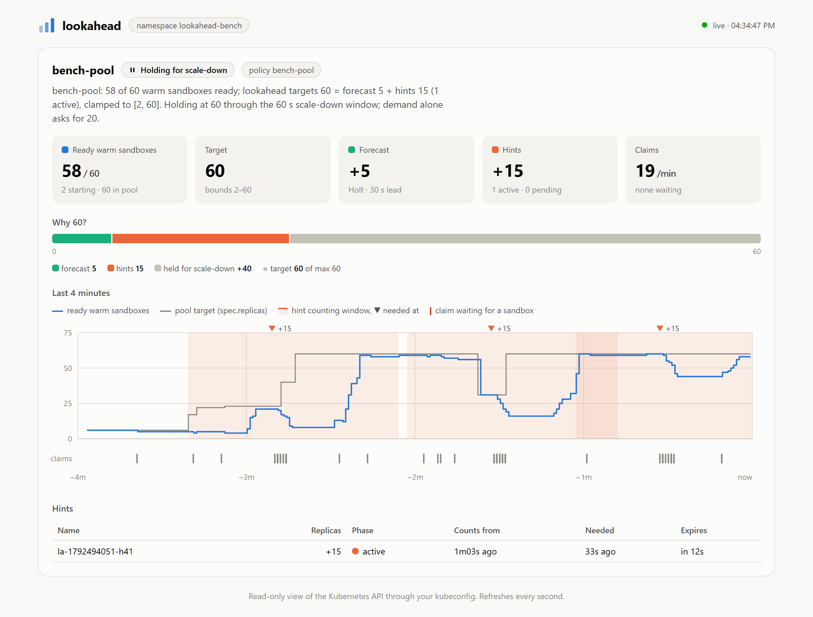

# Using lookahead from coding agents

lookahead is a Kubernetes controller. Agents talk to it by creating **DemandHints**: *"I will
need N sandboxes from pool P in T seconds"*. Agents can do this two ways, and both work
with Claude Code, Codex and any other agent that can run a shell or speak MCP:

| | How the agent sends a hint | Setup |
|---|---|---|
| **MCP server** | calls the `create_hint` tool | one config line per agent ([below](#1-install-the-cli)) |
| **CLI** | runs `lookahead hint create …` in its shell | none beyond installing the binary |

Both paths use your kubeconfig and current context, the same as `kubectl`.

## What the agent gets

| Tool | What it does |
|---|---|
| `pool_status` | One sentence on what lookahead is doing and why, plus a text card: ready sandboxes, the target and its breakdown (forecast + hints), hints and their timing, recent claims. |
| `create_hint` | Creates a DemandHint and reports when it starts counting. If it counts right away, the tool waits up to 5 s for the controller and reports the change, e.g. `target 2 → 6`. |
| `list_hints` | Hints in the namespace with phase (pending, active, expired) and timing. |
| `delete_hint` | Cancels a hint; the pool shrinks after the policy's scale-down window. |

The server also sends instructions on connect, telling the agent to hint before a fan-out and
to show the user the status card.

A real session against the benchmark cluster:

```text
> create_hint {"pool": "bench-pool", "replicas": 6, "in_seconds": 10, "ttl_seconds": 30, "name": "rl-step-7"}

Created demandhint/rl-step-7: +6 sandboxes for bench-pool, needed at 16:30:19, counting until 16:30:49.
lookahead counted it after 300ms: target 2 → 6.

bench-pool: 2 of 6 warm sandboxes ready; lookahead targets 6 = forecast 0 + hints 6 (1 active), clamped to [2, 60].

╭─ bench-pool  lookahead-bench  16:30:09
│ ready     █▒▒▒░░░░░░░░░░░░░░░░░░░░░░░░░░░░░░░░  2 ready · 6 target · max 60
│ target    6 = forecast 0 + hints 6 (1 active) · clamp [2, 60]
│ forecast  Holt · 30 s lead
│ claims    0 in the last minute
│ hints     ● rl-step-7            +6    active   needed in 10s · expires in 40s
│           claims ▁▁▁▁▁▁▁▁▁▁▁▁▁▁▁▁▁▁▁▁▁▁▁▁▁▁▁▁▁▁  per 10s, last 5m
╰─
```

`█` ready · `▒` starting · `░` headroom up to `maxReplicas`.

## Setup

### 1. Install the CLI

```powershell
git clone https://github.com/avanishkasar/lookahead && cd lookahead
go install ./cmd/lookahead        # puts lookahead on your PATH via $(go env GOPATH)/bin
lookahead status -n <namespace>   # check it can reach the cluster
```

### 2a. Claude Code

```powershell
claude mcp add lookahead -- lookahead mcp -n <namespace>
```

Or share it with your team in the project's `.mcp.json`:

```json
{
  "mcpServers": {
    "lookahead": { "command": "lookahead", "args": ["mcp", "-n", "<namespace>"] }
  }
}
```

### 2b. Codex

Add to `~/.codex/config.toml`:

```toml
[mcp_servers.lookahead]
command = "lookahead"
args = ["mcp", "-n", "<namespace>"]
```

### 2c. Any other MCP client

Run `lookahead mcp -n <namespace>` as a stdio server. `-n` sets the namespace used when a tool
call names none.

### 3. Tell the agent when to hint

Put this in the project's `AGENTS.md` (read by Codex) or `CLAUDE.md` (read by Claude Code):

```markdown
## Sandboxes

Before creating more than a handful of SandboxClaims from one warm pool at once (a batch of evals,
an RL step, a fan-out), announce it so lookahead warms the pool first:

- MCP (preferred, if the lookahead server is connected): call `create_hint` with the pool, the
  number of sandboxes and `in_seconds` of at least 30 (the pool's lead time).
- Shell: `lookahead hint create -n <namespace> --pool <pool> --replicas <n> --in 45s --ttl 2m`

Then wait until the hint's needed time (both print "Start creating the claims at …") before
creating the claims; the pool is still warming before that. Afterwards, show the user `pool_status` (or `lookahead status -n <namespace>`). If the work is
cancelled, delete the hint.
```

## Permissions

The agent acts with your kubeconfig. To give it a narrower identity, bind it to a Role like this
one. Sending hints needs only `create`; the read verbs drive `pool_status`.

```yaml
apiVersion: rbac.authorization.k8s.io/v1
kind: Role
metadata:
  name: lookahead-agent
rules:
- apiGroups: ["lookahead.avanishkasar.github.io"]
  resources: ["demandhints"]
  verbs: ["create", "delete", "get", "list"]
- apiGroups: ["lookahead.avanishkasar.github.io"]
  resources: ["lookaheadpolicies"]
  verbs: ["get", "list"]
- apiGroups: ["extensions.agents.x-k8s.io"]
  resources: ["sandboxwarmpools", "sandboxclaims"]
  verbs: ["get", "list"]
```

## Watching it work

| Command | For |
|---|---|
| `lookahead status -n <ns>` | one card per pool, the same text the MCP tools return |
| `lookahead watch -n <ns>` | that card redrawn every second, with a ready-sandbox sparkline |
| `lookahead dashboard -n <ns>` | a live web page on `http://127.0.0.1:8484`: timeline, "why this size" breakdown, hints |

The dashboard is read-only and listens on localhost only, unless you pass `--addr`.

<picture>
  <source media="(prefers-color-scheme: dark)" srcset="img/dashboard-dark.png">
  
</picture>

<sub>Captured during a 4-minute replay of a bursty trace (15-claim bursts, each hinted 40 s ahead).
The "held for scale-down" segment is the stabilization window holding the target after a forecast spike.</sub>
